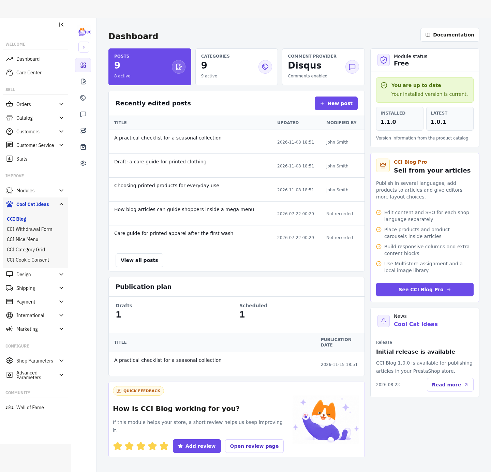
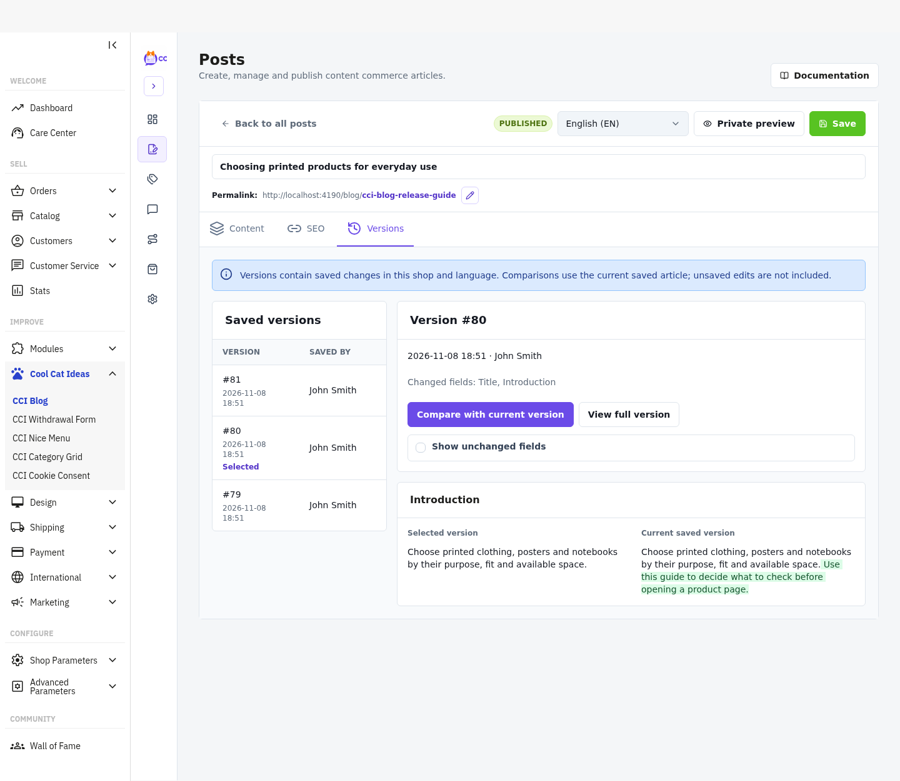
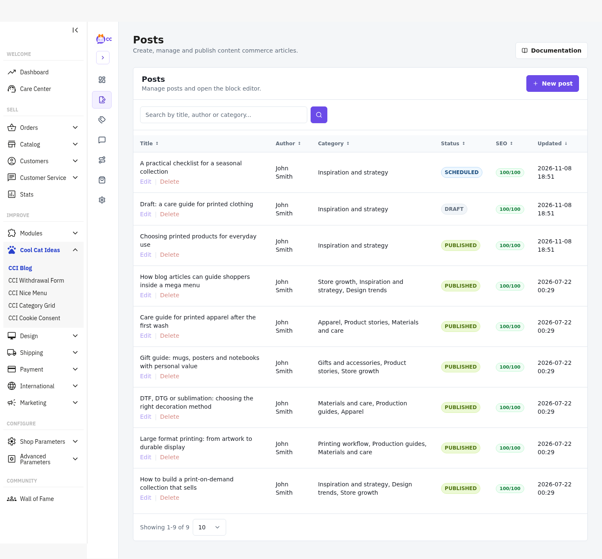
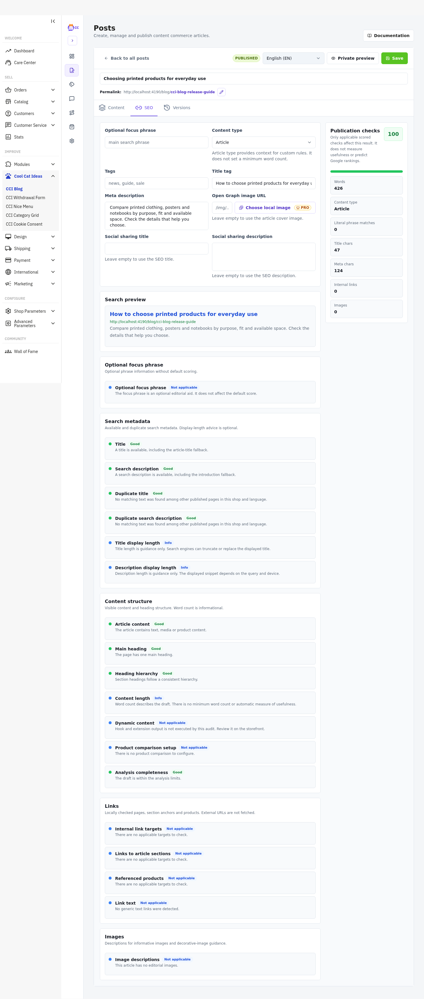
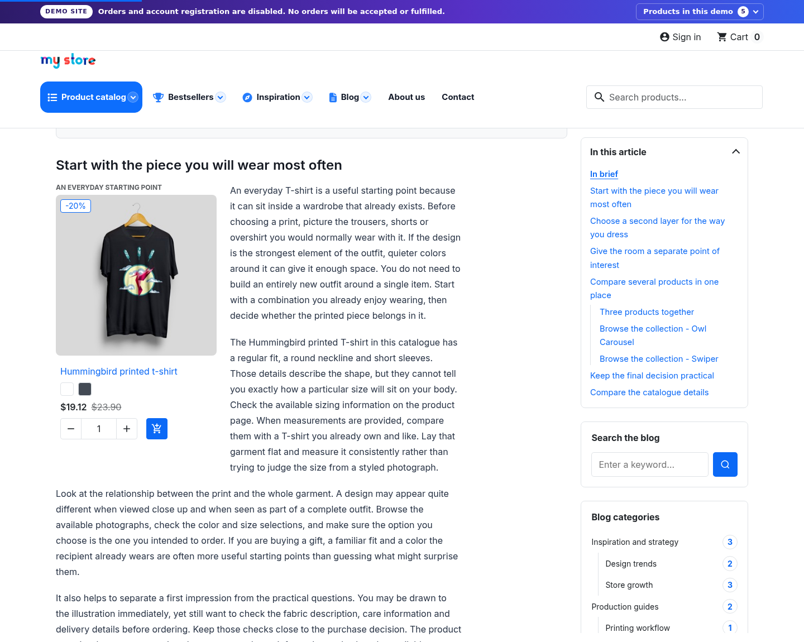
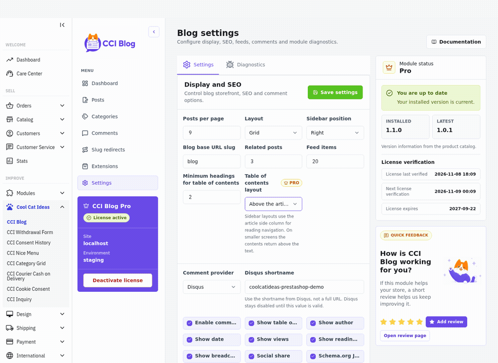

# CCI Blog

Publish buying guides, store news and answers to customer questions under your shop's address. CCI Blog keeps writing, publication and comment moderation in PrestaShop. The visual editor supports headings, images and video; categories, author profiles and tables of contents help readers find their way through the articles.

Download the module ZIP from the [CCI Blog product page](https://coolcatideas.com/products/cci-blog/).

## See what you can build

### Start with the work waiting in your blog

Dashboard shows recent articles, their last recorded editors and the publication plan. Open an article by its title or switch to Posts for the full management table. Empty lists use informational messages.

### Review saved article versions

See who saved an article, when it was saved and which fields changed. Compare a selected version with the current saved article or open its full content and settings. History stays within the article's shop and language.

### Keep the last publication check in the article list

See the saved result alongside each article. A changed dependency marks the result as needing refresh; saving updates it automatically. Opening the list does not run the checks again.

### Check publication details before publishing

One server-side engine checks metadata, headings, links and publication settings. It explains what needs attention and distinguishes unavailable checks. The result does not predict search rankings. Add your own rules through the documented extension hook.

### Recommend products in context with PRO

Place a product beside the text or between sections. Grids, carousels and comparisons use the active theme's product cards. A theme change therefore also changes the cards used in the article.

### Choose a reading layout with PRO

Keep the table of contents above the article, in the sidebar or in a sticky sidebar. On phones it returns above the text. Optional blog navigation and permitted hook content can fill the sidebar below it.

Administration screenshots show the base edition. Product blocks and sidebar table-of-contents examples show the PRO preview. The base edition includes article versions and comparisons, publication checks, saved results, author-written In brief blocks, internal link selection and an inline table of contents. Product blocks, columns and sidebar table-of-contents layouts require PRO, which is currently shown as a preview.

[Explore CCI Blog and compare editions](https://coolcatideas.com/products/cci-blog/) · [Read the documentation](https://coolcatideas.com/docs/cci-blog/1.1.0/)

## Start publishing

1. Download the current CCI Blog ZIP from the product page and install it in **Modules > Module Manager**.
2. Open **Cool Cat Ideas > CCI Blog**.
3. Go to **Categories** and add the first category.
4. Go to **Posts**, create an article and assign its main category.
5. Add headings and text in the visual editor, then publish the article.
6. Open the article on the storefront and check it on desktop and mobile.

To show an author box, edit the employee in **Advanced Parameters > Team > Employees**, open **CCI Blog author profile**, enable the public profile and add a biography. Free saves it in the default shop language. Pro adds a separate biography for every shop language.

If an article does not appear, check its active state, publication date, shop assignment, language and category. Then clear the PrestaShop cache.

The base module works without a license key. CCI Blog Pro is optional and adds more layout, language, Multistore and product-content tools.

[Full documentation](https://coolcatideas.com/docs/cci-blog/1.1.0/)

## Configure and customize

- [Publish an article and configure the blog](docs/USER_GUIDE.md).
- [Change styles, card markup, date format and sidebar](docs/TEMPLATES_AND_STYLING.md).
- [Build an installable editor-block extension](docs/DEVELOPER.md#create-an-installable-editor-block-extension).
- [Hook arguments and examples](docs/HOOKS_REFERENCE.md) and [supported PHP helpers](docs/API_REFERENCE.md).
- [Slugs, redirects and sitemap setup](docs/ROUTES_SEO.md).
- [Publication checks, saved results and custom rules](docs/PUBLICATION_AUDIT.md).
- [Article versions, comparisons and storage](docs/ARTICLE_VERSIONS.md).
- [Summaries, links and product comparisons](docs/EDITORIAL_BLOCKS.md).
- [Table-of-contents layouts and sidebar hooks](docs/TABLE_OF_CONTENTS.md).

Keep changes in a theme or separate module. Do not replace core PHP methods or edit installed module files.

## Support

Use the product repository under https://github.com/orgs/cool-cat-ideas/repositories for public questions and bug reports. This channel has no guaranteed response time. When you need a private request with an agreed scope, buy a support service on the product page; the request and further messages are then handled in the Cool Cat Ideas customer panel.

Release history is available in the [changelog](CHANGELOG.md).

## Building and contributing

See [Build from source](docs/building-from-source.md) for the npm workflow. Shared components, styles and API adapters are maintained in [CCI Admin UI](https://github.com/cool-cat-ideas/cci-admin-ui).
