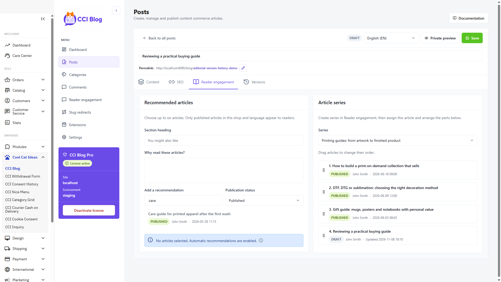
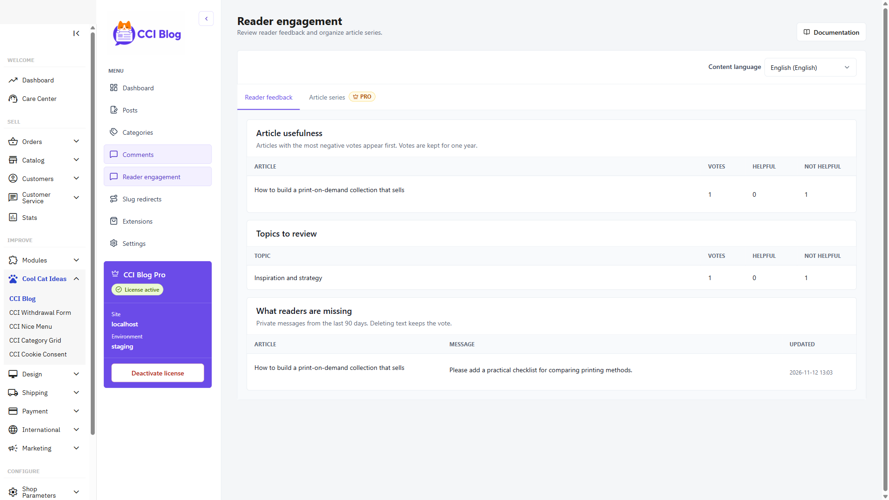
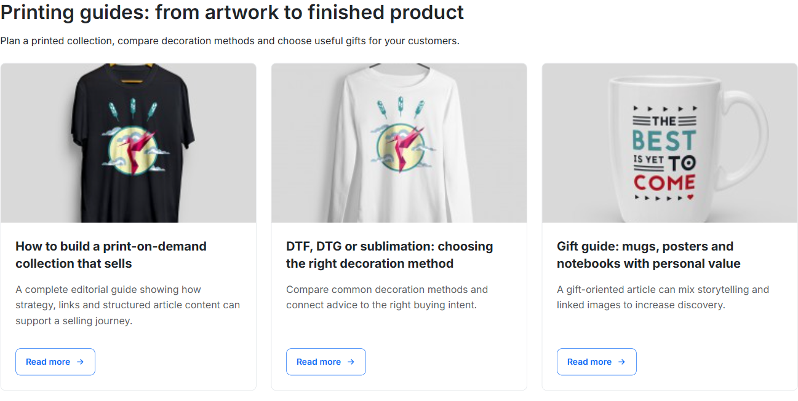

# Help readers continue through your guides

Use recommendations to suggest the next useful article, a series to put a topic
in reading order, and reader feedback to find explanations that need work.
Open **Cool Cat Ideas > CCI Blog > Reader engagement** to review feedback or
manage series. Select the content language before editing translated material.

## Edition availability

| Capability | Base edition | Pro |
| --- | --- | --- |
| Existing automatic related articles | Yes | Yes |
| Usefulness votes without a customer account | Yes | Yes |
| Basic vote totals by article | Yes | Yes |
| Ordered manual recommendations, heading and introduction | No | Yes |
| Article series and public series pages | No | Yes |
| Private written feedback and topic reports | No | Yes |

Reader engagement requires CCI Blog 1.1.1. The Pro capabilities are part of
CCI Blog Pro 1.0.0.

## Recommend a useful next article

1. Open a post and select **Reader engagement**.
2. Type a title or URL slug in **Add a recommendation**. Choose an article
   directly from the search results. Results start with **Published**; use
   **Publication status** to include drafts, scheduled articles or all statuses.
   Status, author and publication date identify each result. Drafts show their
   last update instead. You can select up to six articles.
3. Drag the article rows into reading order. For keyboard control, focus the handle, press Space,
   use the arrow keys and press Space again to drop. Escape restores the original
   order. You can also select a handle and then select the destination without
   dragging. Confirm removal when prompted. Remove detaches the recommendation; it
   does not delete the article.
4. Optionally enter a section heading and explain why these articles are useful.
5. Use the main **Save** button at the top of the editor.

Manual recommendations come first. The existing automatic recommendations
fill remaining places when related articles are enabled in **Settings**.
Setting the related-article count to zero hides the section, including manual
recommendations. Readers see only published, shop-assigned articles with a
title and URL in the current language. Drafts and scheduled posts can be chosen
while editing but remain absent from public recommendations until publication.

## Create and order a series

1. Open **Reader engagement > Article series > New series**.
2. Enter a title, URL slug and description. Keep **Visible to readers** selected
   when the series is ready for publication. Save the series.
3. Open each article, select its **Reader engagement** tab and choose the series.
4. Arrange the parts by dragging their rows or using the keyboard controls on the handle.
5. Use the article editor's main **Save** button. Membership, recommendations
   and the order are committed together; there is no separate order-save action.

You can also open an existing series in the management list and arrange its
articles there. The series save includes its description, visibility and order.
If somebody changes the order or membership in another editor, an outdated save
is rejected. Use **Reload articles** to discard only the pending order and fetch
the current list, leaving the rest of your article draft in place.

An article belongs to at most one series per shop and language. Moving it to
another series leaves the original articles published. A newly assigned article
can be placed in the sequence before its first save. The ordering editor supports
up to 500 articles per series.

The storefront shows the series title, its published parts and links to adjacent
parts. Drafts and future publications do not create gaps pointing to private
pages. The series archive uses the existing article cards and twelve articles
per page. Its first URL is `/blog/series/{slug}` when the blog base slug is `blog`.
Existing series URLs cannot be edited. Hide a series to remove its navigation
and archive without unpublishing the individual articles.

Public, non-empty series are included in the native HTML sitemap and `gsitemap`
XML integration. Each archive page has its own canonical URL. Hidden or empty
series and pages beyond the available articles return 404.

## Understand reader feedback

Readers can answer **Was this article helpful?** without creating a shop account.
With Pro, they can optionally explain what was missing. Written feedback is
private; it is not a public comment and does not replace the existing comment
provider. It is also not a contact form or an order-support request.

**Reader feedback** lists article votes, topics with negative feedback and
private messages. Topic reports use the article's primary category. Use these
signals to decide what needs clarification. They are not a representative survey:
the anonymous browser mechanism limits duplicates and abuse but cannot establish
that every vote is a different person.

Deleting a message removes its text and preserves the vote. Turn off **Show
article usefulness ratings** in **Settings** to hide the form and reject new
submissions without deleting existing results.

## Retention and privacy

Feedback is scoped to the shop, article and language. It is not linked to a
customer account. Storage contains keyed visitor and daily network digests,
not raw IP addresses. A visitor can update their existing vote; it does not add
another vote to that article in the same browser context.

Written messages and network digests are cleared after 90 days; vote records
expire after one year. Cleanup runs during accepted submissions and report
reads. For cleanup on days without traffic, schedule the following supported
CLI command once a day using your hosting provider's scheduler:

```sh
php /path/to/prestashop/modules/cci_blog/cli/cleanup-reader-feedback.php
```

Your backup-retention policy is separate from this runtime cleanup. Readers are
asked not to include personal or order details in their message.

## Templates and troubleshooting

The new views inherit the active PrestaShop theme's font, colors and buttons.
Series archives and recommendations use the existing `_post_card.tpl` partial.
Theme overrides can target `post.tpl`, `series.tpl`, `_reader_series.tpl` and
`_reader_feedback.tpl` under the module's standard Smarty override path. Keep
form tokens, field names, escaped text and accessible labels intact.

- A missing recommendation or part usually means the article is a draft,
  scheduled for later, unavailable in this language or assigned to another shop.
- If a vote fails, reload the article and try again. Full-page caches must not
  reuse a different visitor's form token. Configure the cache's dynamic-fragment
  support or exclude the affected article form from shared HTML caching.
- Frequent submissions are rate-limited. Retrying does not create a second vote.
- Ordinary expiry of a previously valid, signed Pro license preserves published
  series and recommendations on the licensed site. Editing Pro features requires
  an active license. Revoked, deactivated, invalid or foreign-domain licenses do
  not have the same runtime entitlement.

## Interface examples

These captures show Pro 1.0.0 in preparation on the default PrestaShop theme,
with the shared CCI administration components and fictional shop content.







## Review the publication calendar

Dashboard’s **Publication plan** displays the current month in the shop time zone.
Use the previous and next month controls or **Today** to navigate. Dates with
publications show an article count. Select a date to see its articles and open
them for editing. Published and scheduled active articles are included; drafts
stay outside the calendar. Articles without a publication date have no calendar entry. The calendar is
read-only: change publication dates in the article editor and use its main Save
button.
